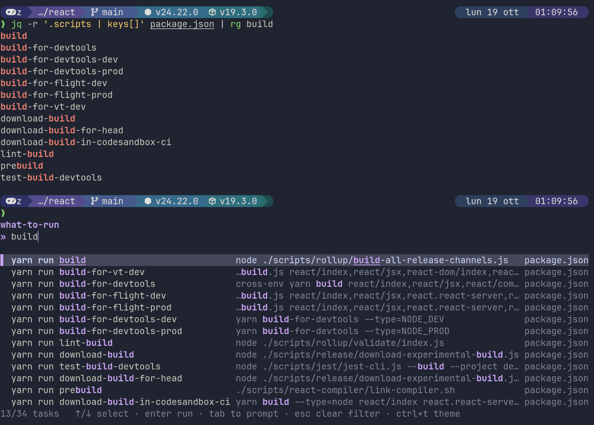

<div align="center">

# What to Run (wtr)

A task picker for the commands you can never remember in a repository.

## Screenshot


</div>

## Why

I built `what-to-run` because I kept opening `package.json`, `Makefile`, or
`Makefile.toml` just to check what the project could run. It discovers those tasks
and makes them available from one key. It is first and foremost a **shell
widget**: selected commands run through your shell and become part of your
normal terminal history.

## Get started

### Install

On macOS or Linux with Homebrew (installs both `wtr` and `what-to-run`):

```sh
brew install zanza00/tap/what-to-run
```

With [mise](https://mise.jdx.dev/) instead:

```sh
mise use -g github:zanza00/what-to-run
```

For the apt repository, `.deb` packages, release tarballs, or `go install`,
see [Installation](docs/install.md).

### Set up the widget

Add this line to your `~/.zshrc` (use `wtr` instead if that is the command name
you installed):

```sh
eval "$(what-to-run init zsh)"
```

The widget is bound to **Ctrl-S** by default. To use another key, for example
Ctrl-G, pass it to `init`:

```sh
eval "$(what-to-run init zsh --key ctrl-g)"
```

Start a new shell, or evaluate the line in your current one, then press the
chosen key at the prompt.

### Set up the bash widget

The same picker is available for bash; add this line to your `~/.bashrc`
(bash 4.3 or later):

```sh
eval "$(what-to-run init bash)"
```

The widget is bound to **Ctrl-S** by default. To use another key, for example
Ctrl-A, pass it to `init`:

```sh
eval "$(what-to-run init bash --key ctrl-a)"
```

### Use the picker

Type to filter the task list and use the arrow keys to select a task. Press
`enter` to run it: the widget submits the command through your shell, so it
appears in your shell history and its output stays in the terminal. Press `tab`
to put the selected command on the prompt without running it. Press `esc` to
clear the filter or close the picker.

### Choose a theme

Press `ctrl+t` while the picker is open to browse themes. Use the arrow keys to
preview them, then press `enter` (or `ctrl+t` again) to select and save your
choice. Press `esc` to cancel and restore the current theme. Your choice is
saved in your user configuration and applies to future runs.

## Task sources

The picker discovers tasks in the current project directory:

| File | Discovered tasks | Command |
| --- | --- | --- |
| `package.json` | `scripts` | `<package-manager> run <name>` |
| `Makefile`, `makefile`, `GNUmakefile` | Targets | `make <name>` |
| `Makefile.toml` | cargo-make `[tasks]` | `cargo make <name>` |
| `devbox.json` | `shell.scripts` | `devbox run <name>` |
| `composer.json` | custom `scripts` (lifecycle events are not listed) | `composer run-script <name>` |
| `deno.json`, `deno.jsonc` | `tasks` | `deno task <name>` |
| `mise.toml`, `.mise.toml` | `[tasks]` | `mise run <name>` |

For `package.json`, the package manager is detected from the `packageManager`
field or a lockfile, with npm as the fallback. The task list shows descriptions
and each task's source file. If one source cannot be parsed, tasks from other
sources can still be shown.

JSON files that allow comments (`devbox.json`, `deno.jsonc`) are parsed as
JSONC. Composer lifecycle events are skipped because Composer runs them
itself, and a `mise.toml` task with only `depends` is still listed, since
`mise run <name>` remains valid.

## Running without the widget

You can also launch the picker directly from a terminal. Use the command name
available on your `PATH` (`wtr` is the short alias):

```sh
wtr          # full-screen picker
wtr --inline # inline picker, below the current prompt
```

Full-screen mode is the default. When you run a task there, the picker returns
after the task finishes; its output remains in the terminal scrollback. Inline
mode is intended for shell widgets and requires an interactive terminal. If the
current directory declares no tasks, the inline picker stays open on a message
listing the files it looked for (close it with `enter` or `esc`), while a
full-screen run reports the error and exits.

## Configuration

Optional TOML files let you add custom tasks, override the package manager, or
disable task sources:

- `.what-to-run.toml` in a project, for settings shared with that repository;
- `$XDG_CONFIG_HOME/what-to-run/config.toml` for personal settings and
  per-project overrides (normally `~/.config/what-to-run/config.toml`).

See [Configuration](docs/config.md) for the full format and examples.

## Development

See [Development](docs/development.md) for build, test, and local widget
instructions.

## License

[MIT](LICENSE)
