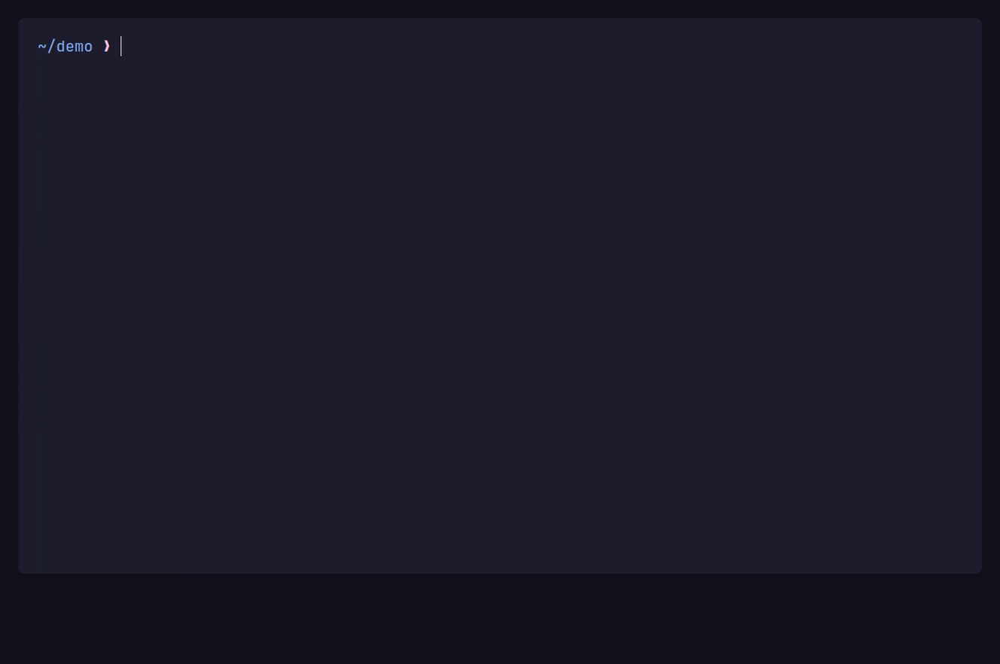

<div align="center">

# What to Run (wtr)

A task picker for the commands you can never remember.



</div>

## Why

I built `what-to-run` because I kept opening project files just to check what a
project could run. It discovers those tasks and makes them available from one
key. It is a **shell widget** first: selected commands run through your shell
and stay in your terminal history.

## Get started

### Install

With Homebrew on macOS or Linux:

```sh
brew install zanza00/tap/what-to-run
```

With [mise](https://mise.jdx.dev/) instead:

```sh
mise use -g github:zanza00/what-to-run
```

On Linux or Apple silicon macOS with [Nix](https://nixos.org/) instead:

```sh
nix run github:zanza00/what-to-run
```

For the apt and RPM repositories, `.deb` and `.rpm` packages, npm, release
tarballs, Windows or `go install`, see [Installation](docs/install.md).

### Set up the widget

Add the line for your shell to its rc file, then start a new shell. To use the
widget right away, `source` the file in the current shell.

```sh
# zsh: ~/.zshrc
eval "$(wtr init zsh)"
```

```sh
# bash 4.3 or later: ~/.bashrc
eval "$(wtr init bash)"
```

```powershell
# PowerShell 5.1 or 7+, in $PROFILE
wtr init powershell | Out-String | Invoke-Expression
```

Ctrl-O opens the widget by default. See [Widget setup](docs/widget.md) for other
keys, shell dialects and running the picker without the widget.

## Task sources

The picker reads tasks from:

- `package.json`
- `Makefile`
- `Taskfile.yml`
- `justfile`
- `Makefile.toml`
- Cargo aliases (`.cargo/config`)
- `devbox.json`
- `composer.json`
- `deno.json`
- `mise.toml`

See [Task sources](docs/task-sources.md) for the commands and caveats.

## Configuration

Two optional TOML files add custom tasks, override the package manager and
disable sources. The global file also sets the theme. See
[Configuration](docs/config.md) for the format, per-project overrides and the
`ctrl+t` theme picker.

## Inspiration

This project is heavily inspired by [television](https://github.com/alexpasmantier/television), [fzf](https://github.com/junegunn/fzf) and [lazygit](https://github.com/jesseduffield/lazygit).

## License

[MIT](LICENSE)
